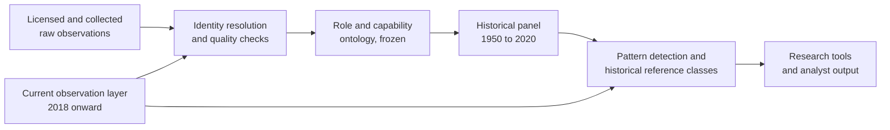

# The panel

## Coverage

| Measure | Value |
|---|---|
| Companies | 4M+ |
| Observed company-year records | 48M |
| Skill rows | 1.88B |
| Capability buckets | 46.5M |
| Countries | 100+ |
| Historical layer | 1950 to 2020, frozen |
| Current layer | 2018 onward, refreshed every 3 to 4 weeks |

Coverage is uneven over time. In the full-panel baseline, usable consecutive-year training pairs ran from 138 in the 1950s to about 1.2M in the 2010s. Most analytical work therefore uses 2000 onward.

## Layers

Vivameda owns the identity layer, the ontology, the historical corpus and the pattern logic. The current observation layer is replaceable by design: the intelligence logic does not depend on any single provider.

The historical and current layers are never spliced into one series per company. The historical panel is the reference corpus with known outcomes; the current layer describes a company today; the two meet through source-relative features such as growth percentile within peers, functional breadth and regime.

## What the numbers mean

- **Observed profiles are not employees.** A count is the number of professional profiles attributed to a company in a year. It tracks organisational size and shape, not payroll.
- **Missing is not zero.** A gap is recorded as a gap, with the last and next observed period.
- **Roles are a distributional view.** Profiles can carry more than one role, so shares can exceed 100% in small companies; an `unknown` bucket marks low-confidence classification.
- **Dating quality varies.** Tenure statistics are not quoted where few profiles carry dates.
- **Reconstruction is retrospective.** The panel was built after the fact, so point-in-time availability of every record is not proven. Studies say when this matters.
- **Placeholder and non-business pages are flagged** (for example "retired" or military entities) and excluded from the default core population of companies with at least 20 observed profiles.
- **There is a known method break** at the 2019 to 2020 boundary. Studies do not read growth across it.
